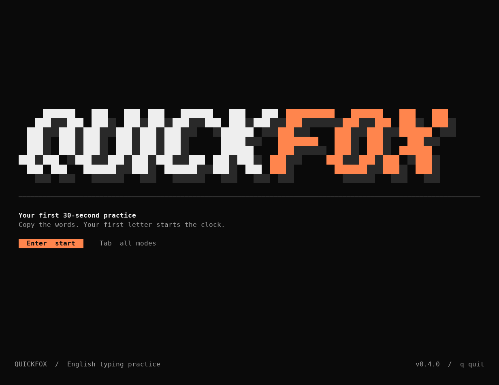
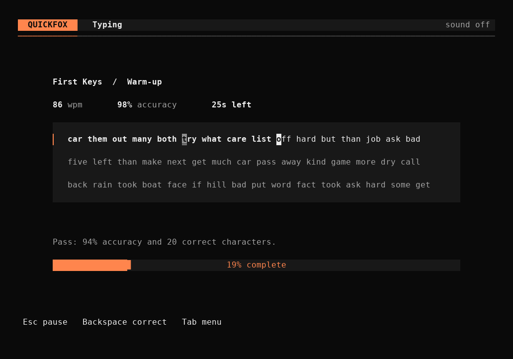
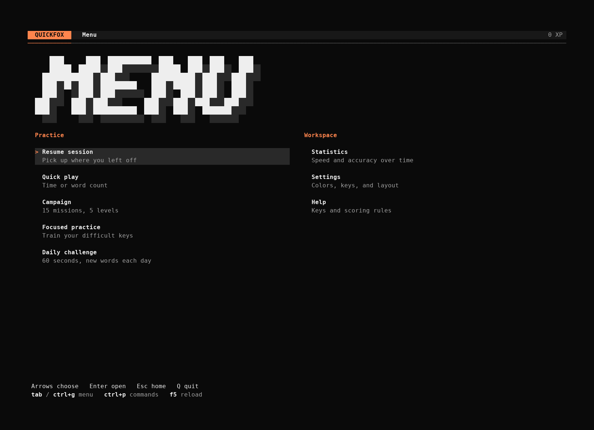
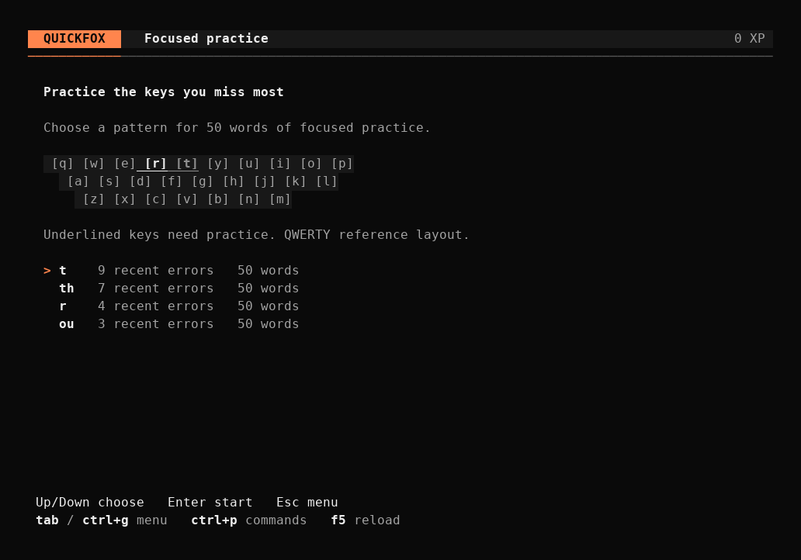
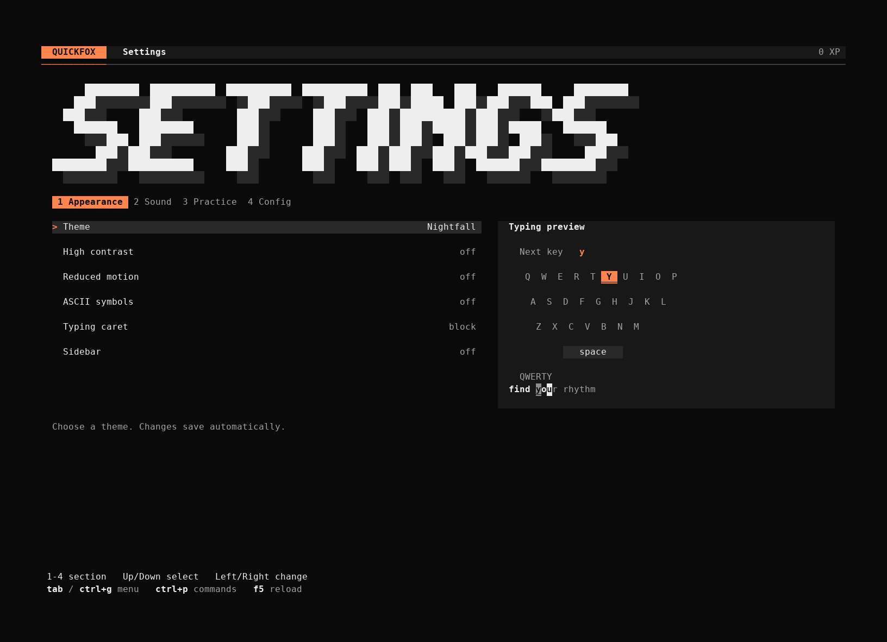
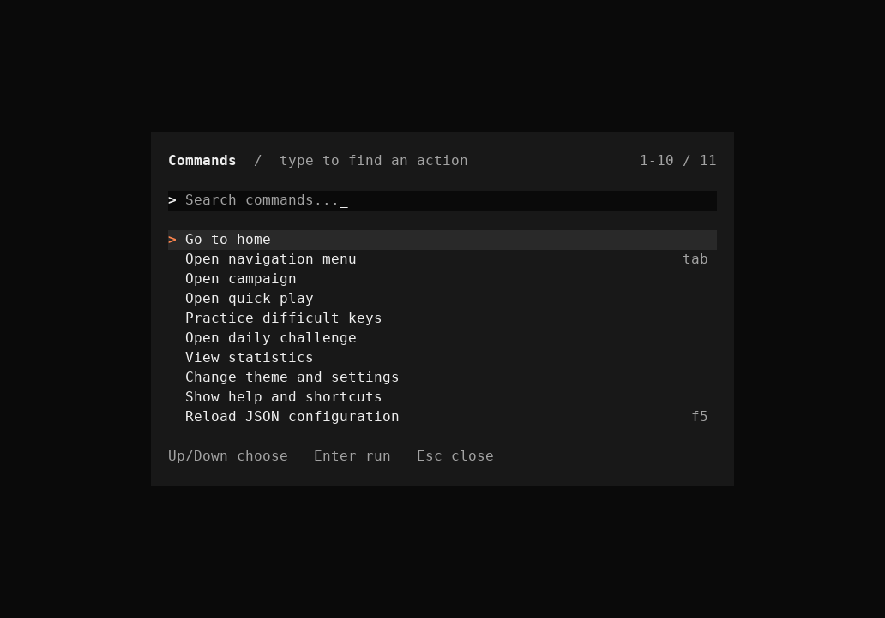

<div align="center">



**Touch typing practice for the terminal.**<br>
Short sessions, five levels, mistakes you can see. Runs offline.


[Install](#install) · [Play](#play) · [Keys](#keys) · [Themes](#themes) · [Config](#configuration) · [Scoring](#how-scoring-works)

</div>

---



## Why Quickfox

- **Starts in one keypress.** Press Enter and type. No account, no setup, no download of word lists.
- **Built for beginners, fine for fast typists.** A 30-second first session with no speed target, then a campaign of 15 missions that only asks for accuracy.
- **Learns what you miss.** New words lean toward the letters and letter pairs you get wrong. Focused practice drills them directly.
- **Honest numbers.** Net and gross WPM, accuracy, and consistency, with the formulas written down below.
- **Small and fast.** A single native binary of about 1.6 MB. Static screens use no CPU while they wait.
- **Yours to change.** 14 themes, an editable JSON config with a schema, custom keybindings and optional key sounds.

## Install

You need **Rust 1.88 or newer**.

```bash
git clone <repository-url> quickfox
cd quickfox
cargo install --path . --locked
quickfox
```

`cargo install` puts the binary in `~/.cargo/bin`. To try it without installing, run `cargo run --release --locked`.

Linux x86_64 is tested. macOS and Windows are in the CI matrix but have not been tried by hand, and key sounds are Linux-only for now. Use a terminal of at least **60 × 20** cells.

## Play

Press **Enter** on the home screen to start your first 30-second practice. Your first letter starts the clock. Press **Tab** to see every mode.

| Mode | What it is |
|---|---|
| **Campaign** | Five levels: First Keys, Flow, Momentum, Precision, Mastery. Each has three missions of 30, 45 and 60 seconds. Pass with **94% accuracy and 20 correct characters**. There is no speed gate. |
| **Quick play** | 30, 60 or 120 seconds, or 25, 50 or 100 words, at any level. Never changes the campaign. |
| **Daily challenge** | The same 60 seconds of words for everyone, every UTC day. Retry as often as you like; your best is kept. |
| **Focused practice** | 50 words built around one letter or pair you miss. A keyboard heatmap shows where your errors are. |
| **Statistics** | Speed, accuracy and XP for your last 100 sessions. |

<table>
  <tr>
    <td width="50%"></td>
    <td width="50%"></td>
  </tr>
  <tr>
    <td align="center">Menu</td>
    <td align="center">Focused practice and heatmap</td>
  </tr>
</table>

From the command line:

```bash
quickfox                       # home screen
quickfox campaign              # next campaign mission
quickfox daily                 # today's challenge
quickfox practice              # your weakest pattern
quickfox play --seconds 30 --level 1
quickfox play --words 50 --level 4
quickfox --theme paperwave     # pick and save a theme
quickfox doctor                # terminal info and save paths
quickfox export > backup.json  # progress as JSON
```

`--data-dir PATH` keeps a separate profile, which is handy for trying things out. `--ascii` and `--reduced-motion` work with every command.

## Keys

| Key | Action |
|---|---|
| <kbd>Enter</kbd> | Start, open, resume |
| <kbd>↑</kbd> <kbd>↓</kbd> or <kbd>J</kbd> <kbd>K</kbd> | Move in menus |
| <kbd>←</kbd> <kbd>→</kbd> | Change a setting or option |
| <kbd>Tab</kbd> / <kbd>Ctrl</kbd>+<kbd>G</kbd> | Menu (pauses typing) |
| <kbd>Ctrl</kbd>+<kbd>P</kbd> | Search commands |
| <kbd>Esc</kbd> | Pause, close, go back |
| <kbd>Backspace</kbd> | Fix the previous character (the mistake still counts) |
| <kbd>R</kbd> | Retry with new words (when paused or on results) |
| <kbd>Q</kbd> | Discard a paused session |
| <kbd>Ctrl</kbd>+<kbd>R</kbd> | Restart; asks first if a session is open |
| <kbd>F5</kbd> | Reload your JSON config |
| <kbd>Ctrl</kbd>+<kbd>C</kbd> | Quit and restore the terminal |

While you type, letters like Q and R are ordinary input. A paused session keeps its words and time until you quit. Losing focus or shrinking the window also pauses.

## Themes

Open **Settings → 1 Appearance**, or start with `--theme NAME`. Changes are saved right away.

| Theme | Colors | Value |
|---|---|---|
| Nightfall | Black, white and gray, with a tangerine brand | `nightfall` |
| Orchid Circuit | Plum, violet, pink | `orchid` |
| Paperwave | Warm paper, deep blue (light) | `paperwave` |
| Ember | Charcoal, peach, amber | `ember` |
| Nord | Slate, icy blue, sage | `nord` |
| Dracula | Charcoal, violet, green | `dracula` |
| Catppuccin | Midnight, lavender, pastels | `catppuccin` |
| Tokyo Night | Indigo, periwinkle, cyan | `tokyo-night` |
| Gruvbox | Charcoal, ochre, cream | `gruvbox` |
| Rose Pine | Plum, rose, gold | `rose-pine` |
| Solarized Light | Cream, teal, olive (light) | `solarized-light` |
| Forest | Deep green, moss, mint | `forest` |
| Custom | Your own colors from JSON | `custom` |
| Mono | Your terminal's colors, styling only | `mono` |

Every built-in palette passes a 4.5:1 contrast check for text. Each color has one job in every theme: the brand color marks the selection and the main action, and the success, error and gold colors only show state. TrueColor, 256-color and 16-color terminals are supported, and `NO_COLOR` is respected.

<table>
  <tr>
    <td width="50%"></td>
    <td width="50%"></td>
  </tr>
  <tr>
    <td align="center">Settings with live preview</td>
    <td align="center">Command palette</td>
  </tr>
</table>

Settings also has high contrast, reduced motion, ASCII symbols, a block or underline cursor, an optional sidebar and adaptive words.

## Key sounds

Sound is off by default. Turn it on in **Settings → 2 Sound**, choose a profile and set the volume (0–200%).

- **Creamy, Soft, Typewriter:** synthesized by Quickfox, no files needed.
- **EG Oreo, NK Cream:** recordings from [Somewhere](https://www.somewheretypingtest.com/), downloaded for personal use with `python3 scripts/install_reference_sounds.py`. They are never bundled.

Only accepted keys and Backspace make a sound. Playback uses `libpulse-simple` (PulseAudio, PipeWire and WSLg). If audio is missing, the game stays silent and Settings says why. Details are in [docs/audio.md](docs/audio.md).

## Configuration

A full `config.json` is created on first launch.

```bash
quickfox config path       # where it is
quickfox config show       # the effective config with defaults
quickfox config validate   # check it without starting the UI
quickfox --config ./mine.json config init   # new file plus quickfox.schema.json
```

Edit the file, then press **F5** in the game. Invalid values are rejected and the last working settings stay active. If you change a setting in the UI after editing the file by hand, Quickfox asks you to reload first instead of overwriting your edit.

```json
{
  "theme": "custom",
  "custom_theme": { "bg": "#0a0a0a", "fg": "#eeeeee", "muted": "#a3a3a3", "accent": "#ff854d" },
  "keybindings": { "menu": "ctrl+g", "commands": "ctrl+p", "restart": "ctrl+r", "reload_config": "f5" },
  "layout": { "prompt_width": 76, "line_spacing": 1 },
  "practice": { "mode": "words", "amount": 50, "level": 2, "adaptive": true }
}
```

<details>
<summary>All options</summary>

- **Custom colors:** `#RRGGBB` values for `bg`, `panel`, `fg`, `muted`, `accent`, `secondary`, `tertiary`, `success`, `error`, `gold`, `selection` and `border`. Missing tokens use Nightfall. They apply only with `"theme": "custom"`.
- **Shortcuts:** F1–F12 or Ctrl+letter. Ctrl+C/H/I/J/M/S/Q/Z are reserved, and duplicates are rejected.
- **Layout:** `prompt_width` 32–100 columns, `line_spacing` 0–2 blank rows, `sidebar` on or off.
- **Practice defaults:** `mode` is `time` (30/60/120) or `words` (25/50/100); `level` is 1–5. Command-line options override them.
- **Color mode:** `auto`, `true-color`, `ansi256`, `ansi16` or `mono`. `NO_COLOR` always wins.

See the [full example](config/example.json) and the [JSON schema](config/quickfox.schema.json).

</details>

## How scoring works

- **Net WPM:** correct characters still on screen ÷ 5 ÷ active minutes.
- **Gross WPM:** every character typed ÷ 5 ÷ active minutes.
- **Accuracy:** correct keypresses ÷ all keypresses. Fixing a mistake does not erase it.
- **Consistency:** `100 × (1 − standard deviation / mean)` of correct keys per five-second window, shown once two full windows exist.
- **XP:** `min(correct / 2, 300)`, plus 50 for a passed mission or 10 otherwise. No correct characters, no XP.

Time stops while paused. WPM shows zero during the first second to avoid spikes. Spaces never skip words. Paste, key repeat and non-ASCII input are ignored where the terminal reports them.

## Your data

Everything stays on your machine. On Linux:

```text
~/.config/quickfox/config.json
~/.local/share/quickfox/progress.json
```

`XDG_CONFIG_HOME` and `XDG_DATA_HOME` are honored; `quickfox doctor` prints the real paths. Saves are written to a temporary file and then swapped in, and a lock stops two copies from writing the same profile. A damaged `progress.json` is kept as `recovered-*` next to the original before a fresh profile starts.

To reset, close the game and delete `progress.json`. To restore a backup, copy an export back to that path.

<details>
<summary>Troubleshooting</summary>

- **"Needs an interactive terminal":** run it directly in a terminal, not through a pipe or an IDE output pane. `doctor` and `export` work anywhere.
- **Odd colors:** check `NO_COLOR`, `TERM` and `COLORTERM`, or try the Mono theme or high contrast.
- **"Profile in use":** close the other window or use `--data-dir`.
- **Broken symbols:** turn on ASCII symbols in Settings or pass `--ascii`.
- **Terminal left in a strange state after a forced kill:** run `reset`.

</details>

## Development

```bash
cargo fmt --all -- --check
cargo clippy --all-targets --locked -- -D warnings
cargo test --locked
python3 scripts/smoke_pty.py      # drives the real binary in a pseudo-terminal
```

Screenshots in this README are rendered from the real UI, without a terminal:

```bash
cargo run --example render_previews
python3 -m venv .preview-env && .preview-env/bin/pip install Pillow
.preview-env/bin/python scripts/render_preview.py   # PNGs in target/previews/
```

More detail: [architecture](docs/architecture.md), [game rules](docs/game-design.md), [audio](docs/audio.md), [benchmarks](docs/benchmarks.md), [distribution](docs/distribution.md), [roadmap](docs/ROADMAP.md).

## License

No license has been chosen yet, so all rights are reserved for now. The bundled word lists are documented in [assets/words/LICENSES.md](assets/words/LICENSES.md).
